<p align="center"></p>

<p align="center">


</p>

<h3 align="center">Give Claude a communications lab bench.</h3>
<p align="center">Signal Lab is a <a href="https://modelcontextprotocol.io">Model Context Protocol</a> server. Ask Claude a question about a radio link,<br>and instead of guessing, it runs a real Monte Carlo simulation and shows you the scope trace.</p>

<table>
<tr>
<td width="50%">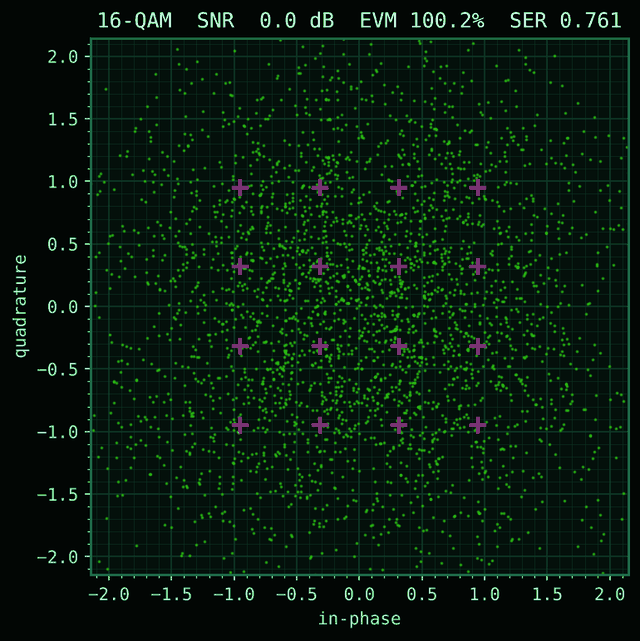</td>
<td width="50%">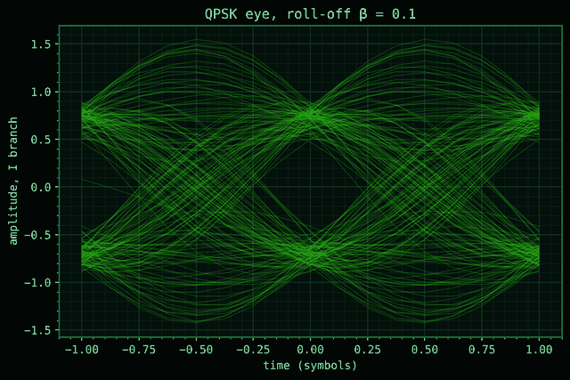</td>
</tr>
<tr>
<td align="center"><sub>16-QAM from 0 to 30 dB SNR: the clouds shrink into 16 points, EVM falls from 100% to 3%</sub></td>
<td align="center"><sub>QPSK eye as the roll-off grows from 0.1 to 1.0: wider bandwidth buys a cleaner eye</sub></td>
</tr>
</table>

---

## 💬 What you can ask

> *"What BER does 64-QAM get at 16 dB over AWGN? Check it by simulation."*
>
> *"Show me a 16-QAM constellation at 20 dB with 3° of phase noise. What is the EVM?"*
>
> *"Run OFDM with 64 subcarriers over a 6-tap channel at 15 dB, LS estimation vs perfect knowledge."*
>
> *"How much bandwidth does a root-raised-cosine with roll-off 0.5 occupy?"*
>
> *"Link budget: 20 dBm at 5.8 GHz over 300 m, 40 MHz, what capacity?"*

Claude picks the tool, fills the parameters, runs it, and answers with the numbers and the plot. Every BER comes with the number of simulated bits, so you know how much to trust it.

---

## 🎛️ The front panel

| | Tool | What it does | Returns |
|:---:|---|---|---|
| 📉 | `ber_curve` | BER vs Eb/N0 for BPSK, QPSK, 8PSK, 16/64/256-QAM over AWGN or Rayleigh fading, next to closed-form theory | table + scope plot |
| ✳️ | `constellation` | Received constellation with AWGN and phase noise | EVM, symbol error rate + plot |
| 📶 | `ofdm_link` | OFDM over multipath with comb pilots, LS or perfect channel estimation | BER, channel NMSE, PAPR + plot |
| 👁️ | `eye_diagram` | Root-raised-cosine shaping and matched filtering | eye opening + plot |
| 🌈 | `spectrum` | Power spectral density of the shaped signal | 99% occupied bandwidth + plot |
| 📡 | `rf_link_budget` | Free-space path loss, received power, noise floor, SNR, Shannon capacity | numbers |
| 💡 | `vlc_los_gain` | Line-of-sight gain of a visible-light link (Lambertian LED, photodiode, concentrator) | numbers |

Bad inputs come back as clear errors Claude can read and fix, for example *"channel_taps must not exceed cyclic_prefix + 1, or symbols will interfere"*.

---

## ⚡ Plug it in

```bash
git clone https://github.com/jafarSalim/mcp-signal-lab.git
cd mcp-signal-lab
pip install -e .
```

**Claude Desktop**: add this to `claude_desktop_config.json` (Settings → Developer → Edit Config) and restart:

```json
{
  "mcpServers": {
    "signal-lab": {
      "command": "python",
      "args": ["-m", "signallab"],
      "cwd": "/path/to/mcp-signal-lab"
    }
  }
}
```

**Claude Code**:

```bash
claude mcp add signal-lab -- python -m signallab
```

**Any MCP client from Python** (this is exactly how the tests and the validation run it):

```python
import asyncio
from mcp.client.client import Client
from signallab.server import mcp

async def main():
    async with Client(mcp) as client:
        result = await client.call_tool("ber_curve", {"modulation": "16QAM", "ebn0_stop_db": 12})
        print(result.content[0].text)          # the numbers, as JSON
        # result.content[1] is the PNG plot

asyncio.run(main())
```

### What happens on a call

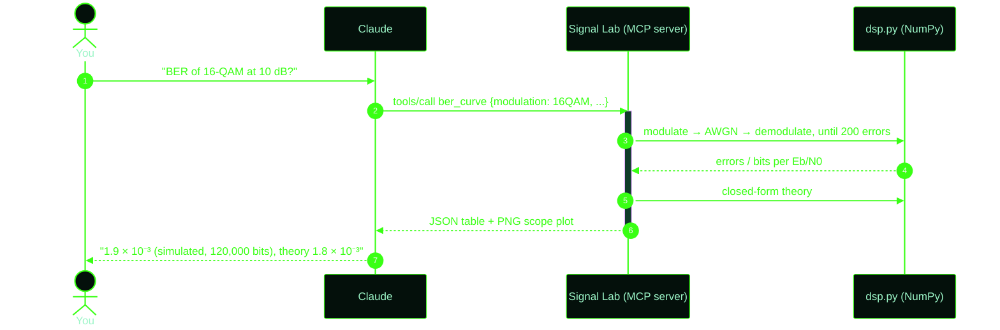

---

## 🧾 Calibration certificate

A lab instrument is only useful if it is calibrated. [`scripts/validate.py`](scripts/validate.py) checks every simulator against closed-form theory and writes [`results/validation.json`](results/validation.json).

### AWGN: all six modulations

<p align="center">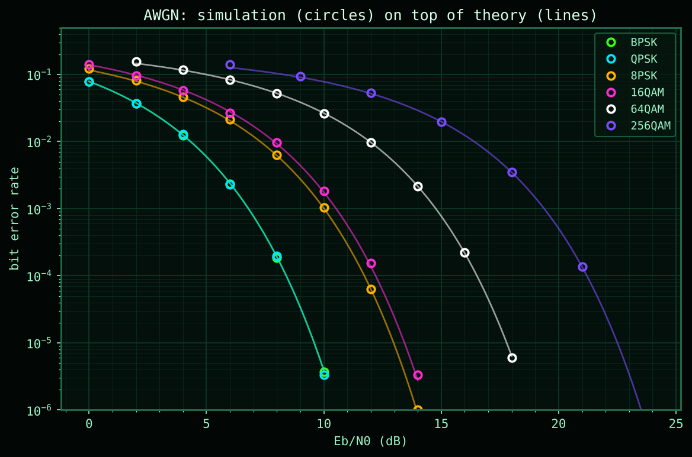</p>

| Modulation | Eb/N0 points | Bits simulated | Example: simulated vs theory | Worst deviation (points with ≥ 300 errors) | |
|---|:---:|:---:|---|:---:|:---:|
| BPSK | 6 | 5.0 M | 1.86 × 10⁻⁴ vs 1.91 × 10⁻⁴ at 8 dB | 2.8% | ✅ |
| QPSK | 6 | 4.9 M | 1.96 × 10⁻⁴ vs 1.91 × 10⁻⁴ at 8 dB | 3.2% | ✅ |
| 8PSK | 8 | 6.6 M | 6.30 × 10⁻⁵ vs 6.34 × 10⁻⁵ at 12 dB | 6.3% | ✅ |
| 16QAM | 8 | 5.5 M | 1.55 × 10⁻⁴ vs 1.39 × 10⁻⁴ at 12 dB | 11.5% | ✅ |
| 64QAM | 9 | 4.9 M | 2.23 × 10⁻⁴ vs 2.17 × 10⁻⁴ at 16 dB | 6.9% | ✅ |
| 256QAM | 7 | 5.6 M | 1.37 × 10⁻⁴ vs 1.35 × 10⁻⁴ at 21 dB | 11.8% | ✅ |

Theory with Gray mapping, $\gamma_b = E_b/N_0$, $k = \log_2 M$:

$$P_b^{\text{BPSK, QPSK}} = Q\big(\sqrt{2\gamma_b}\big),\qquad P_b^{M\text{-PSK}} \approx \tfrac{2}{k}\,Q\big(\sqrt{2k\gamma_b}\,\sin\tfrac{\pi}{M}\big),\qquad P_b^{M\text{-QAM}} \approx \tfrac{4}{k}\big(1-\tfrac{1}{\sqrt M}\big)\,Q\Big(\sqrt{\tfrac{3k\gamma_b}{M-1}}\Big)$$

The QAM and PSK expressions are the standard nearest-neighbour approximations, which is why the largest deviations (about 10%) appear at low SNR for the dense constellations, where errors to non-adjacent points start to matter.

### Rayleigh fading

<p align="center">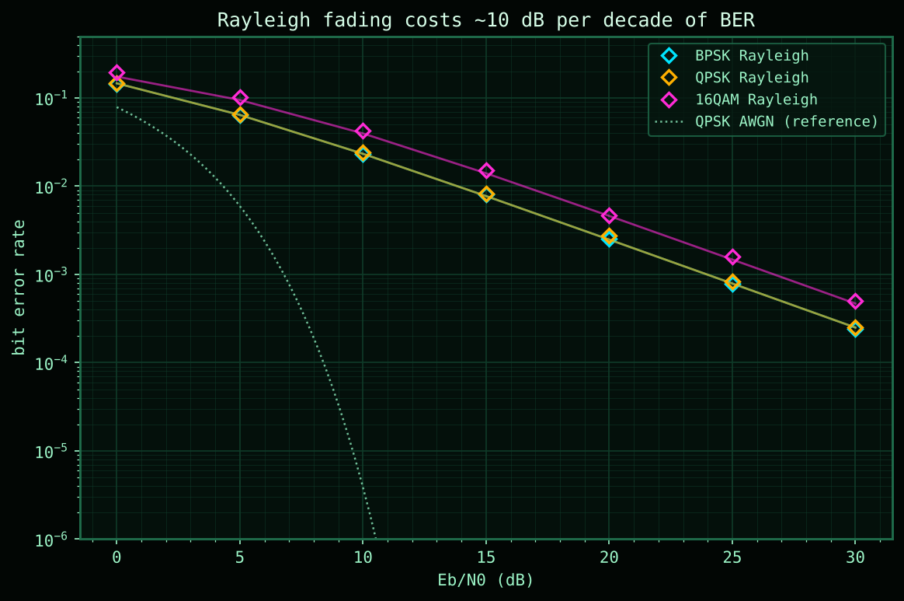</p>

Every expression above has the form $c\,Q(\sqrt{a\gamma_b})$. Averaging over a Rayleigh channel, where $|h|^2$ is exponential, gives an exact closed form:

$$\mathbb E\Big[c\,Q\big(\sqrt{a\gamma_b |h|^2}\big)\Big] = \frac{c}{2}\left(1-\sqrt{\frac{a\gamma_b}{2+a\gamma_b}}\right)$$

| Eb/N0 (dB) | BPSK simulated | BPSK theory | 16-QAM simulated | 16-QAM theory |
|:---:|:---:|:---:|:---:|:---:|
| 0 | 1.45 × 10⁻¹ | 1.46 × 10⁻¹ | 1.97 × 10⁻¹ | 1.75 × 10⁻¹ |
| 5 | 6.38 × 10⁻² | 6.42 × 10⁻² | 1.02 × 10⁻¹ | 9.48 × 10⁻² |
| 10 | 2.33 × 10⁻² | 2.33 × 10⁻² | 4.26 × 10⁻² | 3.96 × 10⁻² |
| 15 | 8.03 × 10⁻³ | 7.72 × 10⁻³ | 1.52 × 10⁻² | 1.40 × 10⁻² |
| 20 | 2.54 × 10⁻³ | 2.48 × 10⁻³ | 4.66 × 10⁻³ | 4.60 × 10⁻³ |
| 25 | 7.86 × 10⁻⁴ | 7.89 × 10⁻⁴ | 1.60 × 10⁻³ | 1.47 × 10⁻³ |
| 30 | 2.42 × 10⁻⁴ | 2.50 × 10⁻⁴ | 5.05 × 10⁻⁴ | 4.68 × 10⁻⁴ |

Fading turns the waterfall into a straight line: every 10 dB of extra power buys only one decade of BER, instead of many. That is the case for diversity and coding in one plot.

### OFDM: what LS channel estimation costs

<p align="center">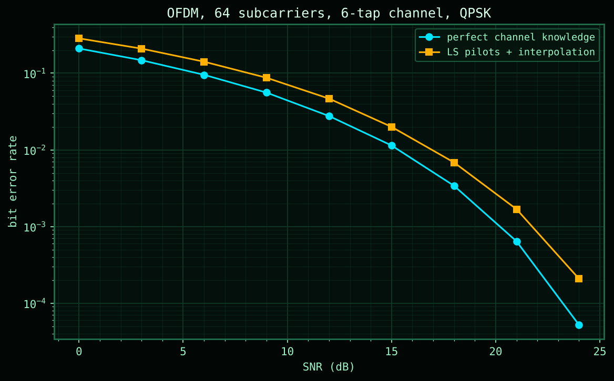</p>

| SNR (dB) | BER, perfect channel | BER, LS + interpolation | Channel NMSE, LS |
|:---:|:---:|:---:|:---:|
| 0 | 2.10 × 10⁻¹ | 2.85 × 10⁻¹ | -1.7 dB |
| 6 | 9.53 × 10⁻² | 1.41 × 10⁻¹ | -7.6 dB |
| 12 | 2.76 × 10⁻² | 4.66 × 10⁻² | -13.1 dB |
| 18 | 3.40 × 10⁻³ | 6.86 × 10⁻³ | -17.8 dB |
| 24 | 5.21 × 10⁻⁵ | 2.08 × 10⁻⁴ | -20.6 dB |
| 30 | 0 | 0 | -21.7 dB |

64 subcarriers, cyclic prefix 16, a pilot on every 4th subcarrier, a 6-tap channel with 3 dB/tap decay, QPSK, 600 OFDM symbols (57,600 data bits) per point. LS costs about 2 to 3 dB. Notice the NMSE column: it improves with SNR and then **stops near −22 dB**. That floor is not noise; it is the error of linear interpolation between pilots on a frequency-selective channel, and it is exactly the gap that MMSE and neural-network estimators try to close.

Peak-to-average power ratio of the OFDM symbols: mean **8.9 dB**, and 1% of symbols exceed **11.6 dB**, the reason OFDM transmitters need power amplifier back-off.

### Pulse shaping: bandwidth vs roll-off

<p align="center">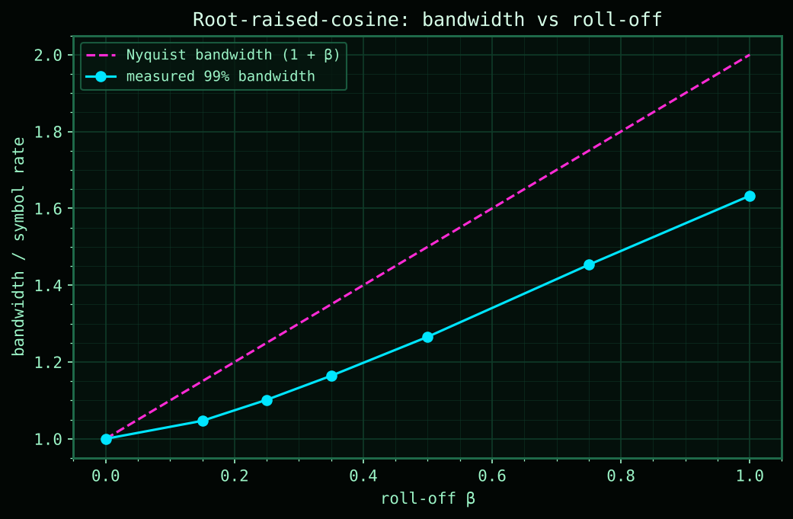</p>

| Roll-off β | 0 | 0.15 | 0.25 | 0.35 | 0.5 | 0.75 | 1 |
|---|:---:|:---:|:---:|:---:|:---:|:---:|:---:|
| 99% bandwidth / symbol rate | 1.00 | 1.05 | 1.10 | 1.16 | 1.27 | 1.45 | 1.63 |

The Nyquist bandwidth $(1+\beta)R_s$ contains all the energy, but 99% of it sits in a noticeably narrower band, because the raised-cosine roll-off region carries little power.

---

## 🔬 Real tool outputs

Every image below was returned by the server over the MCP protocol during validation, with the JSON it sent alongside.

<table>
<tr>
<td width="50%">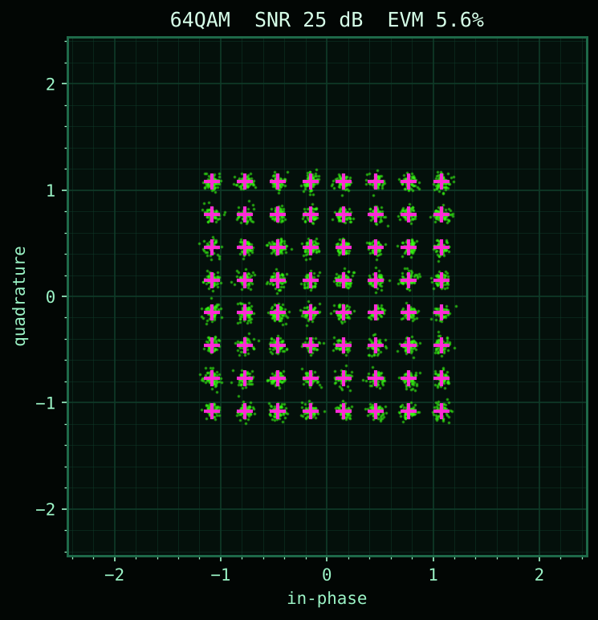</td>
<td width="50%">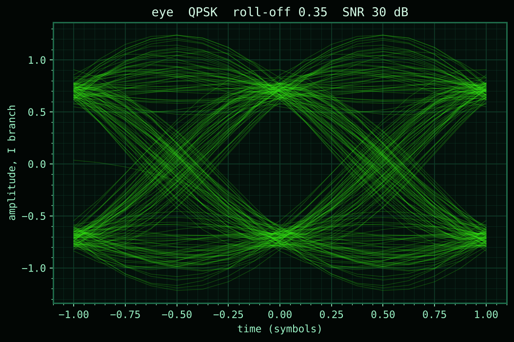</td>
</tr>
<tr>
<td><code>constellation(64QAM, snr_db=25)</code><br><sub>EVM 5.57%, symbol error rate 0 over 4000 symbols</sub></td>
<td><code>eye_diagram(QPSK, rolloff=0.35, snr_db=30)</code><br><sub>eye opening ratio 0.73</sub></td>
</tr>
<tr>
<td>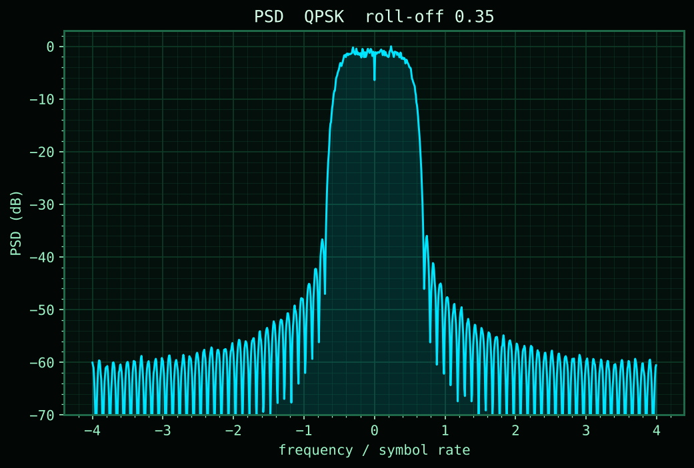</td>
<td>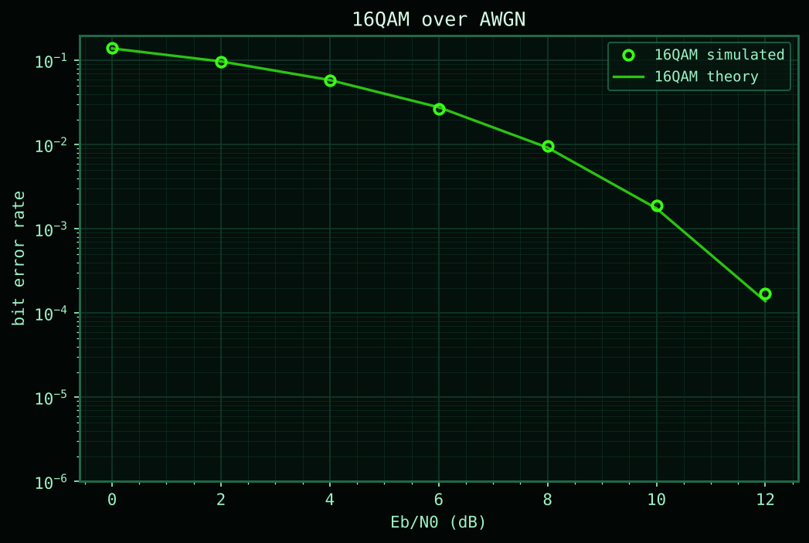</td>
</tr>
<tr>
<td><code>spectrum(QPSK, rolloff=0.35)</code><br><sub>99% bandwidth 1.16 × symbol rate</sub></td>
<td><code>ber_curve(16QAM, 0 → 12 dB)</code><br><sub>7 points, simulation vs theory</sub></td>
</tr>
</table>

<p align="center">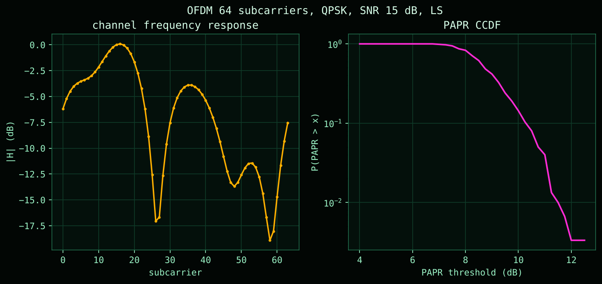</p>
<p align="center"><code>ofdm_link()</code> → BER 1.92 × 10⁻² over 28,800 bits, channel NMSE -15.6 dB, PAPR 99th percentile 11.3 dB</p>

```json
// rf_link_budget()  →  20 dBm, 2 dBi + 2 dBi, 2.4 GHz, 100 m, 20 MHz, NF 7 dB
{"fspl_db": 80.054, "pr_dbm": -56.054, "noise_dbm": -93.99, "snr_db": 37.935, "capacity_mbps": 252.042}
```

### Speed

<p align="center">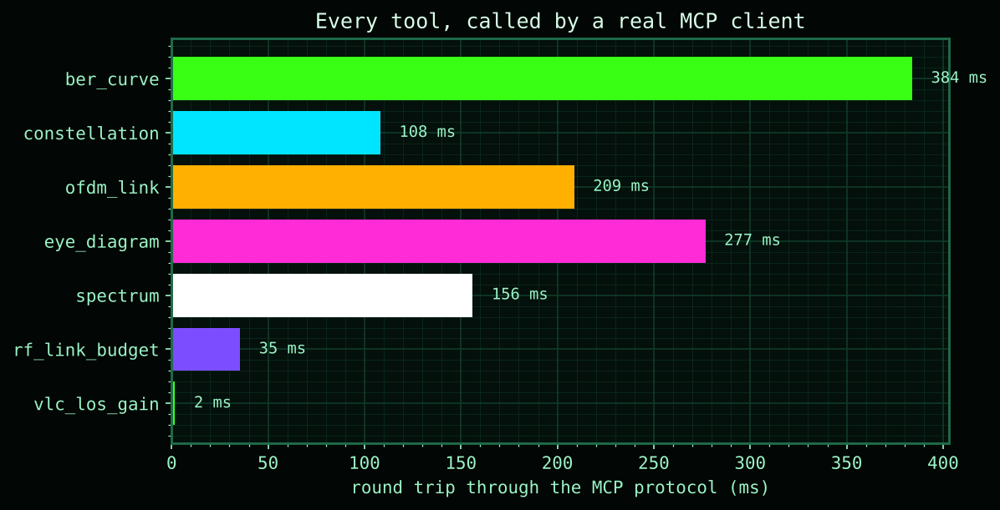</p>

| Tool | Round trip through MCP (laptop-class CPU) |
|---|:---:|
| `ber_curve` | 384 ms |
| `constellation` | 108 ms |
| `ofdm_link` | 209 ms |
| `eye_diagram` | 277 ms |
| `spectrum` | 156 ms |
| `rf_link_budget` | 35 ms |
| `vlc_los_gain` | 2 ms |

Fast enough that Claude can call several tools in one answer without you noticing.

---

## 🗂️ Inside

```text
mcp-signal-lab/
├── signallab/
│   ├── dsp.py          constellations, channels, BER theory, Monte Carlo, OFDM, RRC, link budgets
│   ├── plots.py        oscilloscope-style figures
│   ├── server.py       the 7 MCP tools
│   └── __main__.py     python -m signallab  (stdio transport)
├── scripts/
│   ├── validate.py     calibration against theory + timed MCP round trips
│   └── make_media.py   the two animated GIFs, from real simulations
├── tests/              20 tests: DSP correctness and MCP protocol calls
├── results/            validation.json and every figure above
└── assets/             animated SVG header and GIFs
```

```bash
pip install -e ".[test]"
python -m pytest -q          # 20 passed
python scripts/validate.py   # ~10 s, rewrites results/
python scripts/make_media.py
```

## ⚠️ Limits

* Baseband, discrete-time simulations: no carrier frequency offset, timing recovery or amplifier non-linearity.
* Rayleigh results assume perfect channel knowledge; OFDM uses a static channel per run.
* BER points stop after 200 errors or the bit cap, so very low BERs carry wide confidence intervals; the bit count is always reported.
* The M-PSK and M-QAM theory curves are approximations (exact for BPSK and QPSK).

## 📚 References

* J. G. Proakis and M. Salehi, *Digital Communications*, 5th ed., McGraw-Hill, 2008.
* A. Goldsmith, *Wireless Communications*, Cambridge University Press, 2005 (fading BER, Ch. 6).
* J. M. Kahn and J. R. Barry, "Wireless infrared communications," *Proc. IEEE*, 85(2), 1997 (VLC gain).
* Model Context Protocol specification: [modelcontextprotocol.io](https://modelcontextprotocol.io)

---

<p align="center"><b>Eng. Jaafar Salim</b> · University of Technology, Iraq · <a href="https://github.com/jafarSalim">github.com/jafarSalim</a><br>
If Signal Lab saved you an afternoon of MATLAB, a ⭐ helps other engineers find it.</p>
